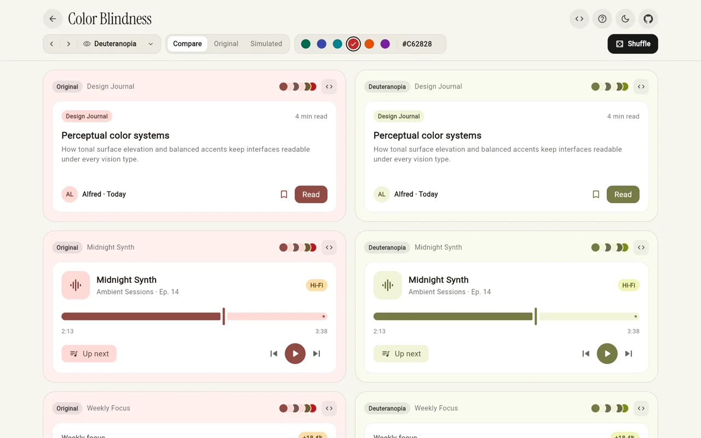

<p align="center">
  
</p>

<h1 align="center">Color Blindness on Flutter</h1>

<p align="center"><strong>Preview how every color in your app shifts under eight color vision deficiencies.</strong></p>

<p align="center">Simulate color blindness across full Material 3 color schemes or individual colors, and compare live interfaces side by side.</p>

<p align="center"><a href="https://bernaferrari.github.io/ColorBlindnessFlutter/"><strong>Try the live demo ↗</strong></a></p>

<p align="center">
  
</p>

## Usage

[](https://pub.dev/packages/color_blindness)

```yaml
dependencies:
  color_blindness: ^0.3.1
```

Wrap your Material 3 `ColorScheme` with `.simulateColorBlindness(...)` (or `colorBlindnessColorScheme(...)`):

```dart
import 'package:color_blindness/color_blindness.dart';
import 'package:material_ui/material_ui.dart';

ThemeData(
  colorScheme: ColorScheme.fromSeed(
    seedColor: const Color(0xFF006C51),
  ).simulateColorBlindness(ColorBlindnessType.deuteranopia),
)
```

Transform individual colors anytime:

```dart
const accent = Color(0xFF9F0042);
final simulated = accent.simulateColorBlindness(ColorBlindnessType.tritanopia);
final direct = tritanopia(accent);
```

- `ColorScheme.simulateColorBlindness(ColorBlindnessType type)` / `colorBlindnessColorScheme(scheme, type)`
- `Color.simulateColorBlindness(ColorBlindnessType type)` / `colorBlindness(color, type)`
- `colorBlindnessAssertContrast(scheme, [minThreshold = 4.5])`
- `colorBlindnessContrastIssues(scheme, {minThreshold = 4.5, includeOnRoles = true})`
- `colorContrastRatio(first, second)`
- Individual functions: `protanomaly`, `deuteranomaly`, `tritanomaly`, `protanopia`, `deuteranopia`, `tritanopia`, `achromatopsia`, `achromatomaly`

## Example

<table>
  <tr>
    <td></td>
    <td></td>
  </tr>
</table>

```sh
git clone https://github.com/bernaferrari/ColorBlindnessFlutter.git
cd ColorBlindnessFlutter/example
flutter pub get
flutter run -d chrome
```

## How It Works

Each simulation transforms a color's RGB channels with a 3×3 channel-mixing matrix adapted from [`jdekock/Colorblinds`](https://github.com/jdekock/Colorblinds) (tracing back to the classic Matthew Wickline / HCIRN RGB-filter approximations). Mixing channels toward shared confusion lines preserves neutral grays while modeling reduced red–green (`protan*`, `deutan*`) or blue–yellow (`tritan*`) cone separation, and `achromatopsia` projects onto ITU-R BT.601 luminance (`0.299 R + 0.587 G + 0.114 B`).

Because these transforms operate directly on normalized sRGB components rather than linearizing into physiological LMS cone space (as in Brettel et al. 1997, Viénot et al. 1999, or Machado et al. 2009), they serve as fast, lightweight visual approximations for UI accessibility previews. Wide-gamut colors in `ColorSpace.displayP3` and `ColorSpace.extendedSRGB` are also supported (`displayP3` is transformed through extended sRGB and converted back to `displayP3`, and `colorContrastRatio` computes physical luminance across all three color spaces). To learn more about LMS cone-space models and matrix approximations, see [DaltonLens: Understanding CVD Simulation](https://daltonlens.org/understanding-cvd-simulation/) and [CVD Simulation SVG Filters](https://daltonlens.org/cvd-simulation-svg-filters/).

Color Blindness on Flutter is open source under the [MIT license](https://github.com/bernaferrari/ColorBlindnessFlutter/blob/main/LICENSE).
