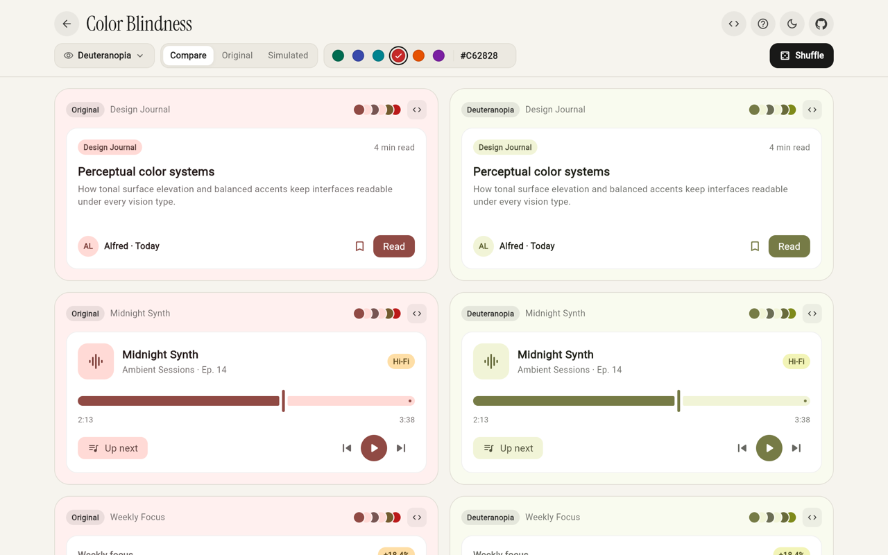
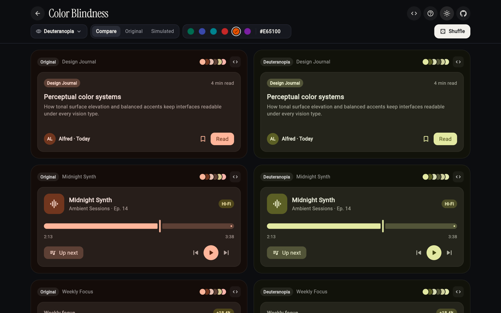

<p align="center">
  
</p>

<h1 align="center">Color Blindness on Flutter</h1>

<p align="center"><strong>Preview how every color in your app shifts under eight color vision deficiencies.</strong></p>

<p align="center">Simulate color blindness across full Material 3 color schemes or single colors, compare live UI side by side, and fail CI builds if contrast drops below WCAG thresholds.</p>

<p align="center"><a href="https://bernaferrari.github.io/ColorBlindnessFlutter/"><strong>Try the live demo ↗</strong></a></p>

<p align="center">
  
</p>

## Usage

[](https://pub.dev/packages/color_blindness)

```yaml
dependencies:
  color_blindness: ^0.3.0
```

Wrap your Material 3 `ColorScheme` with `.simulateColorBlindness(...)` (or `colorBlindnessColorScheme(...)`):

```dart
import 'package:color_blindness/color_blindness.dart';
import 'package:material_ui/material_ui.dart';

ThemeData(
  colorScheme: ColorScheme.fromSeed(
    seedColor: const Color(0xFF006C51),
  ).simulateColorBlindness(ColorBlindnessType.deuteranopia),
)
```

Verify WCAG 2.1 contrast across all 9 modes in unit tests or inspect every role failure programmatically:

```dart
final scheme = ColorScheme.fromSeed(seedColor: const Color(0xFF006C51));

// Throw in CI if primary/secondary contrast on surface drops below 4.5:1
colorBlindnessAssertContrast(scheme, 4.5);

// Or inspect all Material 3 role pairs (including onPrimary, onError, containers)
final issues = colorBlindnessContrastIssues(scheme);
```

Transform individual colors anytime:

```dart
const accent = Color(0xFF9F0042);
final simulated = accent.simulateColorBlindness(ColorBlindnessType.tritanopia);
final direct = tritanopia(accent);
```

- `ColorScheme.simulateColorBlindness(ColorBlindnessType type)` / `colorBlindnessColorScheme(scheme, type)`
- `Color.simulateColorBlindness(ColorBlindnessType type)` / `colorBlindness(color, type)`
- `colorBlindnessAssertContrast(scheme, [minThreshold = 4.5])`
- `colorBlindnessContrastIssues(scheme, {minThreshold = 4.5, includeOnRoles = true})`
- `colorContrastRatio(first, second)`
- Individual functions: `protanomaly`, `deuteranomaly`, `tritanomaly`, `protanopia`, `deuteranopia`, `tritanopia`, `achromatopsia`, `achromatomaly`

## Example

<table>
  <tr>
    <td></td>
    <td></td>
  </tr>
</table>

```sh
git clone https://github.com/bernaferrari/ColorBlindnessFlutter.git
cd ColorBlindnessFlutter/example
flutter pub get
flutter run -d chrome
```

Color Blindness on Flutter is open source under the [MIT license](https://github.com/bernaferrari/ColorBlindnessFlutter/blob/main/LICENSE).
